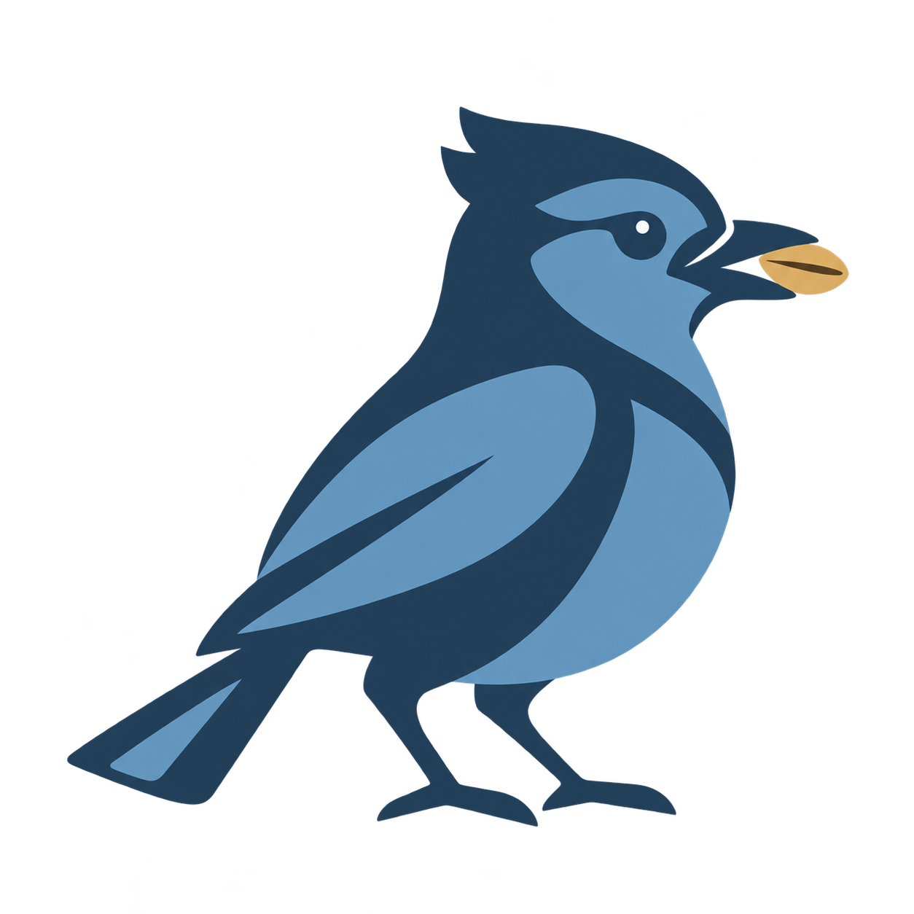

  

# Pinejay

Pinejay is a self-hosted agent built on [NanoClaw](https://github.com/qwibitai/nanoclaw). It runs continuously on a server, its agents run in containers, and each agent can use Claude or Codex. I use it mostly through a Telegram forum group, where each topic has one purpose, such as keeping a journal, taking a course, or receiving a daily digest.

See it at work: **[gegeji.github.io/pinejay-showcase](https://gegeji.github.io/pinejay-showcase/)**. The conversations there are scripted and all data is fictional.

## What it does

- **Courses.** A Telegram topic becomes a course built around your goal. The agent works out a plan with you first; under each lesson there are buttons for the next lesson, another explanation, an example, or practice.
- **Chronicle.** A knowledge graph of your own life with a hand-designed structure: people, places, events, and the statements that connect them, built from what you mention while chatting. Months later, a forgotten moment can still be found, and every answer leads back to the original sentence.
- **Widgets.** When an answer is easier to see than to read, the agent draws a chart, map, or diagram and sends it inside the reply. Each one is checked by an independent reviewer before it goes out.
- **Review.** Once a day it reads the past week across conversations, Chronicle and the feed, and points out what no single conversation shows: recurring problems, unfinished work, and decisions that contradict each other.
- **Weather.** A map every morning, and a message during the day only when rain or heat meets something on your calendar.
- **Feed digest.** Items from X, RSS, podcasts and other sources are scored through the day and summed up in a nightly digest; your replies adjust what it picks next.

Pinejay is developed and kept running by Claude Code and Codex agents: every change is a work item, and the agent that wrote it is never the one that signs it off.

## About this repository

This repository contains only the showcase website: plain HTML, CSS and JavaScript, in English, Simplified Chinese, Traditional Chinese (Hong Kong) and Japanese. Pinejay's own code is not published here.

## Contributing

Pinejay is a personal project. If you want to improve the agent, please contribute to [NanoClaw](https://github.com/qwibitai/nanoclaw) upstream.
